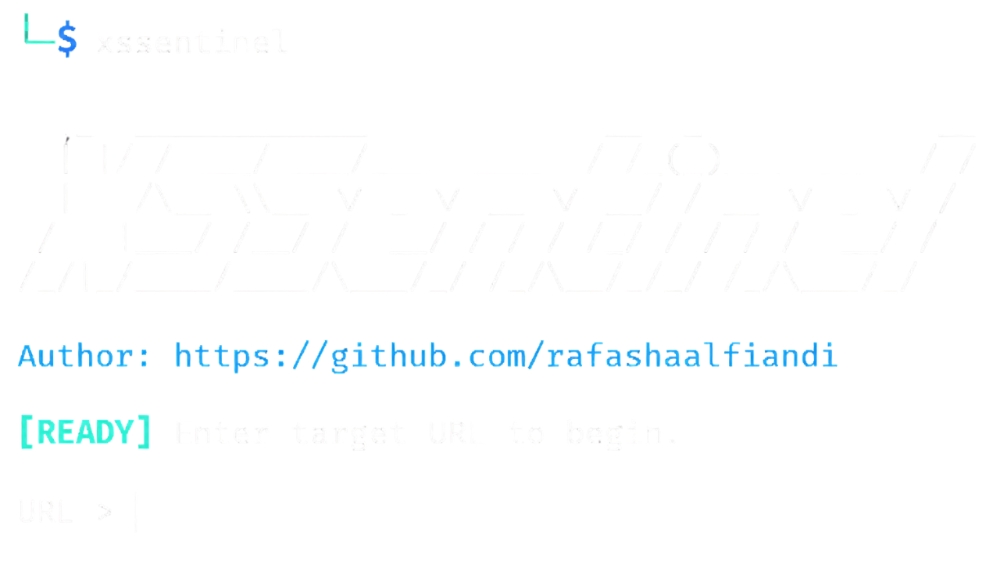
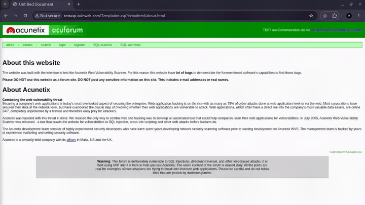
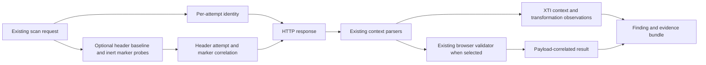

<div align="center">



<br><br>

<h1>XSSentinel</h1>

<p>
  <strong>CLI scanner for authorized XSS testing with reflection checks, browser validation, API evidence, CSP hints, and practical terminal output.</strong>
</p>

<p>
  A focused open-source <strong>cross-site scripting (XSS) scanner</strong> for reflected XSS,
  DOM XSS triage, parameter fuzzing, and browser-based confirmation.
</p>

<p>
  <a href="https://www.python.org/"></a>
  
  
  
</p>

<p>
  <a href="https://github.com/rafashaalfiandi/XSSentinel/issues"></a>
  <a href="https://github.com/rafashaalfiandi/XSSentinel"></a>
</p>

</div>

> XSSentinel is an open-source security testing tool for authorized penetration testing, bug bounty reconnaissance, and defensive web application assessments.

## Contents

- [Overview](#overview)
- [Why XSSentinel](#why-xssentinel)
- [Features](#features)
- [Quick Start](#quick-start)
- [Installation](#installation)
- [Usage](#usage)
- [Upgrading Legacy Installations](#upgrading-legacy-installations)
- [Browser Validation](#browser-validation)
- [Support the Project](#support-the-project)
- [Responsible Use](#responsible-use)
- [Contributing](#contributing)
- [License](#license)

## Demo

<div align="center">



</div>

## Overview

XSSentinel is a Python-based command-line XSS scanner that helps security testers find and triage reflected cross-site scripting, DOM XSS risk, and API responses that reflect input. It tests URL and form parameters, analyzes reflection contexts, and uses browser-assisted validation. The current CLI requires a locally detectable Chromium/Chrome executable; Playwright is an additional supported path, not a substitute for that CLI prerequisite.

XSSentinel does not mark every reflection as confirmed XSS. It separates confirmed browser execution from lower-confidence reflection, API, and risk signals.

The project is built for readable terminal workflows: start with one URL, inspect the evidence, reproduce the result manually, and report only authorized findings.

## Why XSSentinel

XSSentinel is designed for security testers who need useful evidence instead of a noisy payload dump. It combines parameter discovery, context-aware payload prioritization, reflection analysis, API evidence, and optional browser confirmation in one focused CLI workflow.

It is useful for:

- Reflected XSS testing in query strings, forms, and JSON request bodies.
- DOM XSS triage and browser-based confirmation.
- Bug bounty reconnaissance on authorized targets.
- QA regression checks for input encoding and output sanitization.
- Developers learning where untrusted input reaches an HTML or JavaScript context.

The project aims to be fast to try, easy to inspect, and practical to extend with tests and plugins.

## Features

- Scans GET and POST input surfaces discovered from a target URL.
- Tests one parameter at a time by default for clearer evidence.
- Supports multi-parameter testing with `--all-params`.
- Prioritizes high-signal payloads first.
- Shows practical finding markers: `[VALID]`, `[API]`, `[RISK]`, `[LOW]`, `[NO]`, and `[SKIP]`.
- Uses Chromium for browser-assisted confirmation, with Playwright support in applicable paths; the current CLI requires local Chromium/Chrome detection.
- Provides CSP, WAF-like, API, and DOM-risk hints.
- Keeps evidence tied to the tested payload to reduce false-positive browser confirmations.
- Works well for security researchers, bug bounty testers, QA teams, and developers reviewing web input handling.

### Current capability status

This table describes capabilities visible in the current source. “Partial” means the implementation is heuristic or limited; it is not a statement of measured detection accuracy.

| Capability | Status | Notes |
| --- | --- | --- |
| Reflected input analysis | Partial | Parses response reflections and selected HTML, JSON, JavaScript, and CSS contexts. A reflection is not a confirmed vulnerability. |
| Browser-assisted validation | Partial | Looks for correlated alert/confirm/prompt dialog evidence; runtime/browser coverage has not been benchmarked. |
| DOM XSS analysis | Partial | Separates static source and sink indicators and reports simple identifier-linked candidates; no scope-aware or verified data-flow analysis. |
| Stored/second-order XSS | Not implemented | No cross-request write/read workflow; no scan state is written as part of this feature. |
| HTTP header diagnostics | Partial | Opt-in inert reflection checks for `User-Agent`, `Referer`, and `Accept-Language`; no exploit payloads or XSS confirmation are generated by the header stage. |
| Adaptive probe selection | Partial | Payload ordering and fallback are context-heuristic/static; no response-driven branch planner is integrated. |
| JSON report | Partial | `--json-report PATH` writes a versioned report for findings; raw payloads, request/response bodies, and headers are omitted. Redaction is best-effort and the report is not a complete reproduction package. |
| Scope and request controls | Partial | Optional exact-origin allowlist, same-origin HTTP redirects/browser resources, one shared scan-wide HTTP/browser request budget and rate limiter, plus a per-browser-run cap. |
| XSS Trace Intelligence (XTI) | Partial | Correlates response/browser evidence with attempts; unique inert markers are currently used only for opt-in header diagnostics, not ordinary parameter or cross-request tracing. |
| Response transformation observations | Partial | Recognizes selected exact encoded representations and a weak prefix-only observation; no per-attempt baseline or general deletion/normalization inference. |

## XSS Trace Intelligence (partial)

The scanner assigns a scan ID and a unique attempt ID before dispatching each normal scan request. The opt-in header diagnostic stage likewise creates its attempt and marker IDs before sending a request, uses a unique inert marker in the selected header, and records a separate baseline attempt/response fingerprint. The finding evidence bundle includes target/request fingerprints (hashes, not raw additional fields), input location, payload/context/response identifiers, a browser run ID when browser validation runs, context fingerprints, observed response representations, and evidence IDs linked to the same attempt. Agent decision traces are filtered by attempt ID rather than copied from globally recent messages.

Context categories are based on the current response parser's evidence: HTML text, HTML attribute, HTML comment, JavaScript response, URL-related HTML attributes, JSON, or unknown. A context label is not proof of execution. Transformation observations are exact response representation matches (such as HTML entity or URL encoding/decoding candidates); they do not establish safety or JavaScript execution. There is no separate baseline response comparison, and deletion or normalization is not generally inferred.

The target-intelligence stage examines bounded inline and same-origin script text and records heuristic source indicators, sink indicators, and simple identifier-linked candidates. A candidate is not a verified flow: the analyzer does not resolve JavaScript lexical scope, aliases, control flow, sanitizers, or dynamic code. Static hints do not promote a finding to confirmed XSS, and browser runtime DOM taint verification is not implemented.

XTI metadata is exposed in the finding as `attempt_id`, `xti_status`, and `trace_intelligence`, and is copied into the existing `evidence_bundle`. Legacy `Finding.status` values and terminal markers remain unchanged for compatibility.

| XTI status | Meaning in current implementation |
| --- | --- |
| `NOT_REFLECTED` | A response was available but no reflection was found by the existing analyzers. |
| `REFLECTED` | A reflection exists, but the current parser could not assign a supported context. |
| `CONTEXT_IDENTIFIED` | A reflection has a parser-supported context; this is not a vulnerability verdict. |
| `POTENTIAL_XSS` | Existing high-severity reflection evidence occurred in a recognized HTML attribute or URL-related context; browser execution is not established. Static DOM source/sink hints do not independently trigger this status. |
| `BROWSER_EVIDENCE` | A popup-like browser event was observed during the attempt, but it did not satisfy payload correlation; it is not confirmed XSS. |
| `CONFIRMED_XSS` | Existing browser validator returned a popup event matching a function/token expected from the current payload. |
| `INCONCLUSIVE` | The response was empty or an HTTP server-error response did not support a reflection conclusion. |
| `BLOCKED_OR_UNREACHABLE` | A network error, configured HTTP skip, or selected blocking-like status prevented a useful conclusion. |

For ordinary parameter payload attempts, `marker_id` remains `null`; independent marker injection is not applied across all scanner traffic. When header diagnostics are explicitly enabled, a unique inert marker is actually sent in the configured header and correlated with the response. That proves only that a marker representation was observed; it does not prove header acceptance in general, executable output, or XSS. No stored/second-order workflow is implemented. Browser correlation remains limited by the popup-focused verifier and is not a complete DOM/runtime trace.

## Opt-in header diagnostics (partial)

Header diagnostics are disabled by default. Enable them with `--test-headers`; optionally select a comma-separated subset from the supported allowlist using `--test-headers=Referer,User-Agent`.

```bash
xssentinel --test-headers=Referer "https://authorized.example/search?q=test"
```

The current safe allowlist is `User-Agent`, `Referer`, and `Accept-Language`. Routing, authentication, cookie, and proxy-control headers are intentionally not accepted. The diagnostic stage uses a GET target only, sends one baseline request, then one inert unique-marker request per selected header through the configured HTTP service and shared request governor; the header count is capped by the allowlist. It records `marker_reflected`, `marker_transformed`, or `marker_not_observed`; the last outcome does not prove the header was ignored, and server acceptance is intentionally recorded as unknown. Reflections are classified by the existing response parser, but header diagnostics do not submit executable payloads or claim XSS confirmation. POST-only scans skip this stage. A reflected marker's evidence and status are included in the regular Finding, terminal result, and JSON report. The local integration test runs the normal `scan()` orchestration against a loopback HTTP fixture in three modes: text reflection, percent-encoded marker, and ignored marker.

Header markers remain in the XTI `marker_id` and `payload_id` metadata as identifiers/fingerprints; the raw marker value is present in the in-memory diagnostic Finding payload, so do not log or share raw Finding objects. JSON reporting omits raw payloads and snippets.



Run the test suite locally with `python -m unittest discover -s tests -p "test_*.py" -v`. The added XTI tests use inert strings, local parser fixtures, and stubbed browser results; they do not contact external targets or launch a browser.

## JSON finding report (partial)

Use `--json-report PATH` to write a versioned JSON report after a scan. The writer refuses to overwrite an existing path. For example, on a target you are authorized to test:

```bash
xssentinel --json-report findings.json "https://authorized.example/search?q=test"
```

The report contains the legacy status and XTI status, attempt and evidence IDs, target origin, context fingerprints, selected transformation observations, browser event kinds (not dialog messages), and summary counts. It intentionally omits URL paths/query values, raw payload text, request bodies, response bodies, request headers, and response snippets (snippet fields indicate `snippet_included: false`). It records the report generation time; scan completion timing and completeness statistics are not currently collected, so the report labels completion as `partial_or_unknown`. Redaction is best-effort and is not a substitute for protecting report files or reviewing them before sharing.

The legacy `summary.http_transport_requests` object retains Python HTTP-only `used` semantics. `summary.request_accounting` reports the shared budget's `total_used`, `browser_used`, `browser_run_count`, and per-channel counts. Scope-rejected requests are not counted; each Python retry/redirect hop and each allowed browser HTTP(S) request consumes exactly one shared slot. A blocked off-origin browser request does not consume a slot.

The report schema currently uses `schema_version` `1.0`. It is not a complete reproduction package and does not establish exploitability for `POTENTIAL_XSS`, reflection-only, or inconclusive results.

## Quick Start

```bash
git clone https://github.com/rafashaalfiandi/XSSentinel.git
cd XSSentinel
chmod +x install.sh
./install.sh
xssentinel "https://target.test/search?q=test"
```

Only scan targets that you own or are explicitly authorized to test.

## Responsible Use

Use XSSentinel only on applications you own or have explicit permission to test. Unauthorized scanning can disrupt systems and may violate laws, contracts, or acceptable-use policies.

## Installation

```bash
git clone https://github.com/rafashaalfiandi/XSSentinel.git
cd XSSentinel
chmod +x install.sh
./install.sh
```

Verify the command:

```bash
xssentinel -h
```

If `xssentinel` is not found, add `~/.local/bin` to your `PATH`:

```bash
export PATH="$HOME/.local/bin:$PATH"
```

## Usage

### Basic scan

```bash
xssentinel "https://target.test/search?q=test"
```

If no URL is supplied, XSSentinel opens an interactive prompt. Only scan targets that you own or are explicitly authorized to test.

### Scan modes

Test all query parameters in one request:

```bash
xssentinel --all-params "https://target.test/search?q=test&category=test"
```

Stop after the first confirmed browser execution:

```bash
xssentinel --stop-on-confirmed "https://target.test/search?q=test"
```

Load URLs from a file. Each line should contain a URL with parameters:

```bash
xssentinel -f urls.txt
```

Load a raw HTTP request and test its GET or POST parameters:

```bash
xssentinel -r request.txt
```

Raise the default eight-field limit for form or JSON-body tests:

```bash
xssentinel --max-fields 12 -r request.txt
```

Show the complete command reference:

```bash
xssentinel -h
```

Update or reinstall the runtime:

```bash
xssentinel -update
xssentinel -restart
```

### CLI reference

| Command or option | Description |
| --- | --- |
| `xssentinel <url>` | Scan a target URL. Prompts for a URL when omitted. |
| `--all-params` | Send each payload to all query parameters in one request. |
| `--stop-on-confirmed` | Stop after the first confirmed result. |
| `-f`, `--file` | Load target URLs from a file. |
| `-r`, `--request` | Load a raw HTTP request file. |
| `--max-fields N` | Override the default eight-field cap. |
| `--json-report PATH` | Write a redacted JSON report without overwriting an existing file. |
| `--test-headers[=NAMES]` | Opt in to inert GET reflection diagnostics for the allowlisted header set; optional selection is comma-separated. |
| `-update` | Pull the latest source and reinstall the runtime. |
| `-restart` | Clean the cache and reinstall from the saved source project. |
| `-h`, `-help` | Show help and examples. |

By default, XSSentinel tests one parameter per request for clearer evidence, tests discovered parameters in parallel, and continues with other targets after a confirmed result. File modes use the parameters already present in the file and test POST data first.

### Scope and request safety configuration

The HTTP transport rejects redirects that change scheme, host, or port. Browser validation likewise blocks navigation/resources outside the initial target origin, which can prevent third-party scripts needed by some pages from loading. Automatic retry is limited to GET; POST and other methods are not retried by the HTTP helper. Python HTTP requests and intercepted browser HTTP(S) requests now use the same thread-safe scan-wide budget and start-rate governor. Browser validation also has a per-run request cap (default 100), configurable with `XSSENTINEL_BROWSER_MAX_HTTP_REQUESTS` (1–1000). The global request rate is configured with `XSSENTINEL_REQUESTS_PER_SECOND`; browser requests can be further paced by `XSSENTINEL_BROWSER_HTTP_REQUESTS_PER_SECOND` (0.1–30). Target worker limits can be set with `XSSENTINEL_MAX_WORKERS` (non-browser default 10) and `XSSENTINEL_BROWSER_WORKERS` (browser default 4), each clamped to 1–32. An optional environment allowlist can additionally restrict which initial origins may be requested:

```bash
XSSENTINEL_SCOPE_ORIGINS="https://app.example.test,https://staging.example.test" xssentinel "https://app.example.test/search?q=test"
```

Entries must be exact origins (scheme, hostname, optional port), with no path, query, fragment, or credentials. When unset, the operator-supplied initial target is accepted; this does not mean it is authorized. The scan-wide default budget is 5000 attempted HTTP requests across Python transport and intercepted browser requests. Configure it with `XSSENTINEL_REQUEST_BUDGET` (1–100000); retries and redirect hops count as separate requests. Scope-rejected or browser-denied requests are not counted because they are not sent. These controls are safety bounds, not a substitute for authorization or application-specific scope approval.

## Upgrading Legacy Installations

Older XSSentinel releases expected the payload catalogs in the repository root. Current releases keep them inside `xssentinel_core/manifest/payloads/` and no longer install payload files at the runtime root.

Because an older updater runs before the new updater is installed, users upgrading from a legacy release may need this one-time migration:

```bash
cd ~/.local/share/xssentinel-source
git pull --ff-only origin main
rm -f xss-payloads.txt smart-selected-180-payloads.txt
bash ./install.sh
hash -r
xssentinel -update
```

After this migration, future `xssentinel -update` commands use the new updater and do not require payload files in the root directory.

Show help:

```bash
xssentinel -h
```

## Output Markers

| Marker | Meaning |
| --- | --- |
| `[VALID]` | Browser execution was confirmed. |
| `[API]` | An API or data response reflected input and needs manual sink validation. |
| `[RISK]` | Strong reflection signal, but browser execution was not confirmed. |
| `[LOW]` | Reflection exists, but confidence is lower. |
| `[NO]` | No useful evidence was found for that attempt. |
| `[SKIP]` | The target was unreachable or skipped after repeated unsuitable responses. |

## Browser Validation

The current CLI checks for a locally installed Chromium/Chrome executable before starting a scan. Playwright can be used as a browser implementation/fallback in supported paths, but installing Playwright alone does not bypass that CLI prerequisite. If validation cannot produce browser evidence, reflection and API signals remain unconfirmed leads.

The CLI verifies HTTPS certificates by default. Chromium is launched without disabling its sandbox; run the scanner as an unprivileged user in an environment where Chromium sandboxing is available. The command line currently does not expose a certificate-verification override.

Install Chromium on Debian/Ubuntu-based systems:

```bash
sudo apt install chromium
```

Or install Playwright support:

```bash
python3 -m pip install playwright
python3 -m playwright install chromium
```

The Playwright package and browser installation do not replace the CLI's local Chromium/Chrome detection requirement in this version.

## Terminal output and sensitive data

Terminal rendering now applies best-effort redaction to URL userinfo, common credential-bearing query parameter names, header lines, and key/value fields. Ordinary URL query pairs retain their original encoded representation for debugging. This is a display safeguard, not a guarantee that arbitrary secrets are detected. Raw finding objects and evidence held in memory are not rewritten, and custom secret formats, secrets embedded in free-form prose, and unusual encoding schemes may not match the redaction patterns. Avoid putting credentials or sensitive data in target URLs, request files, or public logs.

## Known limitations

- The scanner does not implement stored/second-order workflows or executable header fuzzing; it only performs the opt-in inert diagnostics described above.
- Marker injection is limited to opt-in header diagnostics; ordinary parameter probes do not receive independent marker IDs. There is no adaptive response-driven planner or automatic application-state write workflow.
- JavaScript source/sink matching is heuristic and does not prove data flow.
- Browser validation is popup-oriented; absence of a popup does not establish that a page is safe.
- Request/response and browser evidence have not been evaluated against a reproducible benchmark in this repository.
- HTTP redirects and browser requests are restricted to the starting origin; an optional exact-origin allowlist can constrain initial and subsequent requests further. Cross-origin browser resources are blocked and may reduce validation coverage.
- The CLI verifies HTTPS certificates and keeps the Chromium sandbox enabled by default.
- Browser integration coverage is limited to interception fixtures unless a local Chromium/Playwright runtime is installed and exercised; this environment did not provide Playwright/Chromium for an end-to-end browser run.
- Terminal redaction is best-effort only; it does not sanitize all in-memory evidence or arbitrary user-defined secrets.

## Changelog

### Unreleased

- Added best-effort terminal redaction for sensitive URL credentials/query values, common secret assignments, and sensitive header lines.
- Added regression tests for URL credentials, encoded/camelCase secret parameter names, normal query preservation, malformed URLs, text/header redaction, discovery output, and confirmed-summary output.
- Added opt-in header diagnostics for `User-Agent`, `Referer`, and `Accept-Language`, integrated after the normal target scan through the shared HTTP service and governor. Added a local HTTP fixture covering reflected text, percent-encoded marker, and ignored marker responses, including Finding, lifecycle, terminal output, XTI, and JSON report integration.
- Added CLI selection/allowlist tests and pre-dispatch request-ID correlation checks for baseline and header marker requests.
- Header diagnostics record a baseline attempt, marker attempt, attempt/evidence IDs, and a conservative outcome in XTI; they do not assert server acceptance or XSS from reflection.
- Added partial XTI attempt identity, response/context fingerprints, conservative representation observations, canonical XTI status metadata, and per-attempt agent trace filtering. Existing CLI statuses remain available.
- Added XTI parser, classification, browser-correlation, and concurrent evidence-isolation regression tests. General parameter marker injection, stored tracing, and additional browser interactions were not added.
- Added versioned, redacted JSON report serialization and the `--json-report PATH` CLI option. The writer refuses to overwrite existing files and excludes raw payload/request/response bodies and headers.
- Added report schema, redaction, no-overwrite, CLI parser, and main-flow integration tests.
- Added a thread-safe scan-wide HTTP request budget and global request-start rate limiter; same-origin redirect hops count against both controls.
- Unified intercepted browser HTTP(S) and Python HTTP/redirect attempts under the same scan-wide budget and pacing governor; retained a per-validation browser cap and legacy Python-only report counter, with combined by-channel totals added to JSON reporting.
- Enforced same-origin HTTP redirects, optional exact-origin allowlisting via `XSSENTINEL_SCOPE_ORIGINS`, and same-origin browser navigation/resource routing.
- Enabled HTTPS certificate verification by default in CLI scans, removed Chromium's `--no-sandbox` flag, stopped automatic retries for POST, and isolated unexpected worker exceptions into partial results.
- Expanded context/intelligence cache keys with hashed body/header shape and relevant request configuration.
- Added passive DOM source/sink indicators and simple identifier-linked heuristic candidates to target intelligence; integration tests exercise them through `scan()` and a loopback fixture. No taint flow is claimed or recorded as verified.
- JSON reports omit response snippet text to reduce accidental leakage of arbitrary response data.
- General parameter marker injection, write/read stored-XSS testing, response-driven adaptive probing, and verified taint/data-flow analysis remain unimplemented; the implemented header markers are diagnostic only and are not exploit payloads.
- No accuracy, coverage, or performance benchmark is claimed.

## Support the Project

If XSSentinel helps with research, QA, or defensive security work, a coffee helps keep maintenance, testing, and documentation moving.

<p>
  <a href="https://etherscan.io/address/0xd1915d2D117aA1b8C832c4aA6DF1dD4D8E336Ff9"></a>
  <a href="https://www.blockchain.com/explorer/addresses/btc/1336ujHfSXmkGdtP1nDKxfx6ZPh75xDRPp"></a>
</p>

### Donation Addresses

| Network | Address |
| --- | --- |
| Ethereum (ETH) | `0xd1915d2D117aA1b8C832c4aA6DF1dD4D8E336Ff9` |
| Bitcoin (BTC) | `1336ujHfSXmkGdtP1nDKxfx6ZPh75xDRPp` |

Always verify the address and network before sending. Never send assets from an unsupported network or exchange format.

## Contributing

XSSentinel is maintained by [Rafasha Alfiandi](https://github.com/rafashaalfiandi). Contributions from security researchers, Python developers, QA engineers, and documentation contributors are welcome.

<p align="left">
  <a href="https://github.com/fahmiammar" title="Fahmi Ammar">
    
  </a>
  <a href="https://github.com/ruyynn" title="ruyynn">
    
  </a>
</p>

**Collaborators:** [Fahmi Ammar](https://github.com/fahmiammar) and [ruyynn](https://github.com/ruyynn)

To contribute to this project, open an issue or pull request with a focused, reproducible improvement. Useful contributions include:

- Report reproducible bugs with the target behavior, command, environment, and expected result.
- Add focused tests for scanner decisions, payload parsing, browser evidence, and false-positive prevention.
- Improve documentation, examples, payload context handling, and platform support.
- Open a pull request with a small, clearly described change.

Please read [SECURITY.md](SECURITY.md) before reporting a security issue. Do not include private target data, credentials, or unauthorized scan results in public issues.

### Suggested contribution flow

```bash
git checkout -b improve-xss-detection
python -m unittest discover -s tests -p "test_*.py"
git diff --check
```

Keep changes focused, add a regression test for bug fixes, and explain how the result was verified.

## Troubleshooting

### `xssentinel: command not found`

Add `~/.local/bin` to your `PATH`:

```bash
export PATH="$HOME/.local/bin:$PATH"
xssentinel -h
```

### Chromium was not detected

Install a Chromium/Chrome executable that is discoverable on `PATH`, then rerun the command. Installing only the Playwright Python package does not satisfy the current CLI prerequisite.

### `[API]` appears but there is no popup

That is expected. API responses usually return data instead of rendering HTML directly. Treat `[API]` as evidence that needs manual validation in the frontend that consumes the response.

### Many `[RISK]` or `[LOW]` results appear

The payload was reflected, but execution was not confirmed. Common causes include browser validation being unavailable, sanitization, CSP, or the endpoint returning data instead of rendered HTML.

### The scan feels slow

Large targets and many discovered inputs can take longer. Start with a specific URL when you want a faster focused scan.

## Uninstall

```bash
./uninstall.sh
```

## License

XSSentinel is released under the Apache License 2.0. See [LICENSE](LICENSE) for details.
